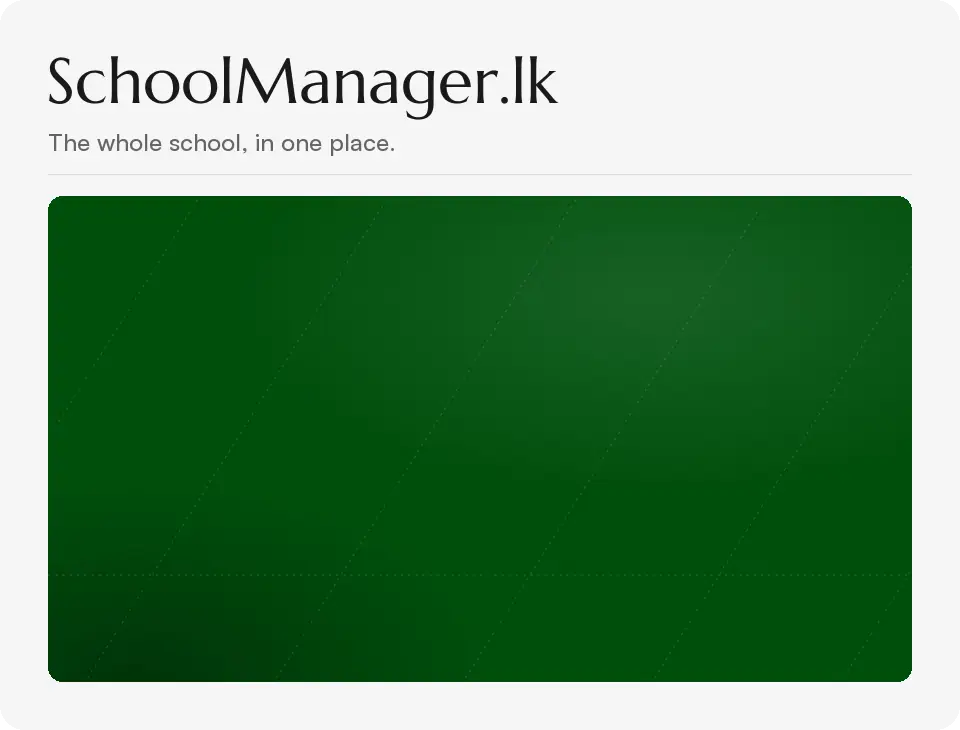
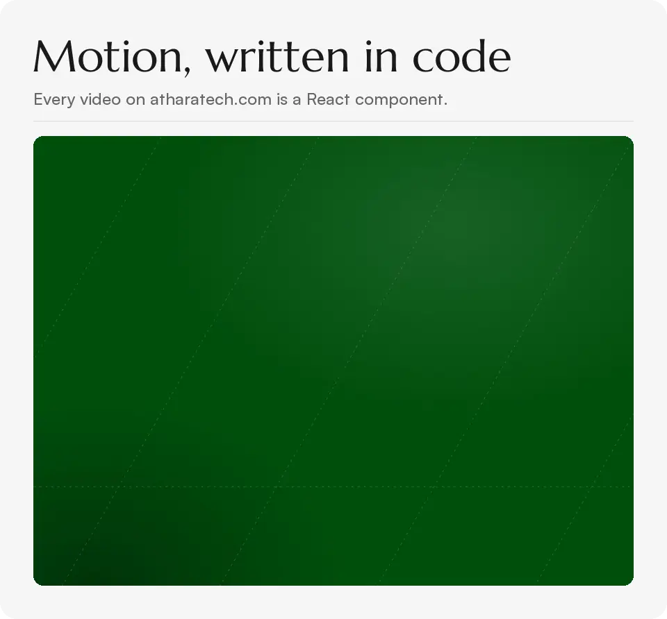

I build software at Athara Technologies and I'm finishing a full stack engineering course at Java Institute. I care about the details people only notice when they're wrong: a report card that adds up, a message that reaches the right parent, a page that still works on a cheap phone.

<picture>
  <source media="(prefers-reduced-motion: reduce)" srcset="assets/schoolmanager.png" />
  
</picture>

**SchoolManager.lk** runs exams and report cards, student and staff attendance, fees and a student portal. Parents get a WhatsApp message when their child arrives, when results are out, and when fees are due.

 

<picture>
  <source media="(prefers-reduced-motion: reduce)" srcset="assets/motion.png" />
  
</picture>

**[atharatech.com](https://atharatech.com)** is built with Next.js, GSAP and Lenis, in light and dark. The product and service videos on it, like this one, are React components rendered to video with Remotion, so changing one is a code change, not a trip back to an editing app.

 

I work mostly in TypeScript, Java and Python, with Next.js, Odoo and PostgreSQL, and I ship with Docker and GitHub Actions.

 

Reach me on [LinkedIn](https://www.linkedin.com/in/atheef-muhammadh/) or at [atheef@atharatech.com](mailto:atheef@atharatech.com).
